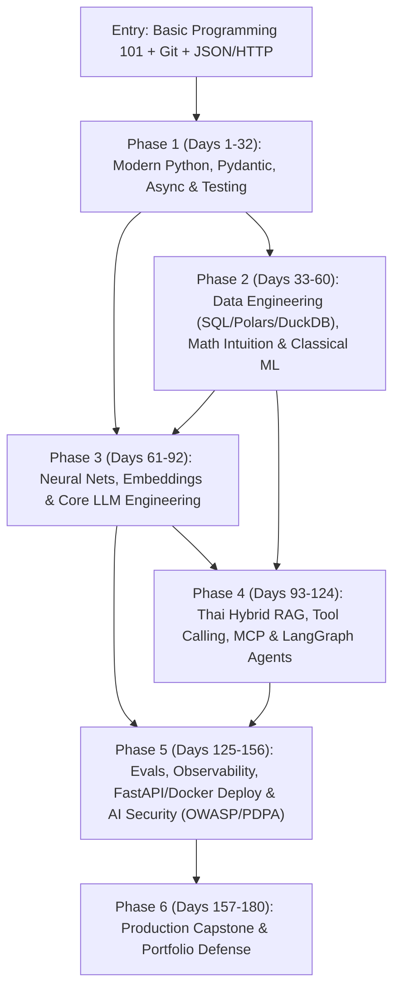

# 180-Day AI Engineer Curriculum (30 นาที/วัน)

> **กลุ่มเป้าหมาย**: Thai Junior Web/App Developers (~1 ปีประสบการณ์) และนักศึกษาปี 1 สาย CS/IT/SE  
> **รูปแบบการเรียน**: 180 วัน × 30 นาที/วัน (รวม 90 ชั่วโมง) · ภาษาไทยพร้อมศัพท์เทคนิคภาษาอังกฤษ · **Review/Checkpoint ทุก 4 วัน** (45 รอบ) · **End-to-End Capstone**

---

## 1. Curriculum Outcomes (จบ 180 วัน ทำอะไรได้จริง)

เมื่อจบหลักสูตร ผู้เรียนจะมีทักษะพร้อมทำงานตำแหน่ง **Junior AI Engineer / Applied AI Developer** พร้อมผลงานจริงใน GitHub 6 ชิ้น:
1. **Typed Async Python CLI & API Client** (`uv`, `Pydantic v2`, `httpx`, `pytest`)
2. **Tabular ML Baseline Pipeline** (`Polars`, `DuckDB`, `scikit-learn`/`LightGBM` + Proper Validation)
3. **Production LLM Structured Extractor** (Schema validation, retries, fallback, token/cost budget)
4. **Thai-Ready Hybrid RAG Engine** (`PyThaiNLP` BM25 + Dense Vector + Reranking + Citations)
5. **Automated Eval & Security Suite** (`Promptfoo`/`Ragas` CI evals, OWASP checks, PDPA PII redaction)
6. **Capstone Production System**: ระบบ **Thai/Bilingual Enterprise Knowledge & Support AI Assistant** ที่ Deploy ด้วย `FastAPI` + `Docker` + `MCP` Tooling + `Langfuse`/OpenTelemetry Tracing และผ่าน Eval Gate อัตโนมัติ

---

## 2. Prerequisite Map & Entry Readiness

### Dependency Graph



### Entry Readiness & Track Bridging

| พื้นฐานที่ต้องมีก่อนเริ่ม | Junior Web/App Dev (~1 ปี) | First-Year Student | การช่วยปรับพื้นฐานในหลักสูตร |
| :--- | :--- | :--- | :--- |
| ตัวแปร, Loop, Function, Array/Map | คล่องแล้ว | เรียนแล้วในวิชา 101 | ใช้โจทย์จริงตั้งแต่วันที่ 1 ไม่เสียเวลาวน syntax พื้นฐานนาน |
| Git, Terminal, `.env`, HTTP/JSON | คล่องแล้ว (Fast-track ได้) | มักยังไม่ชิน | ใส่กล่อง *First-Year Note* อธิบาย CLI/HTTP/Secrets สั้น ๆ ใน Phase 1 |
| Python ecosystem (`uv`, `Pydantic`, `asyncio`) | ใหม่สำหรับสาย JS/TS | ใหม่ | ใส่กล่อง *Web Dev Bridge* เทียบกับ `pnpm`, `Zod`, `Promise.all` |
| Vector, Cosine Similarity, Probability | ลืมหรือยังไม่เคยใช้ | พอมีพื้นฐาน | สอนแบบ Visual + Code Intuition ใน Phase 2 ไม่เน้นพิสูจน์สูตรยาว |

---

## 3. Roadmap Overview & 4-Day Review Cadence

### โครงสร้าง 6 Phases (180 วัน / 90 ชั่วโมง)

| Phase | ช่วงวัน | จำนวนวัน (ชม.) | โฟกัสหลัก | Portfolio Milestone |
| :--- | :--- | :---: | :--- | :--- |
| **Phase 1** | Days 1–32 | 32 วัน (16 ชม.) | Modern Python, `uv`, `Pydantic`, `asyncio`, `pytest` | Resilient Async Data Fetcher CLI |
| **Phase 2** | Days 33–60 | 28 วัน (14 ชม.) | `Polars`/`DuckDB`, Math Intuition, `scikit-learn`, `LightGBM` | Churn/Ticket Priority ML Pipeline |
| **Phase 3** | Days 61–92 | 32 วัน (16 ชม.) | `PyTorch` Basics, Embeddings, LLM APIs, Structured Outputs | Typed Thai Document Classifier & Extractor |
| **Phase 4** | Days 93–124 | 32 วัน (16 ชม.) | Thai Hybrid RAG (`PyThaiNLP` + Vector + Rerank), Tools, `MCP`, `LangGraph` | Thai Knowledge RAG + Controlled Agent |
| **Phase 5** | Days 125–156 | 32 วัน (16 ชม.) | Evals (`Promptfoo`/`Ragas`), `Langfuse`/OTel, `FastAPI`/`Docker`, OWASP & PDPA | Evaluated & Guarded AI Microservice |
| **Phase 6** | Days 157–180 | 24 วัน (12 ชม.) | End-to-End Production Capstone & System Defense | Deployed Production Thai AI Assistant |

### กติการอบทบทวนทุก 4 วัน (Review Cadence)
ทุก 4 วัน (**Day 4, 8, 12, ..., 180**) เป็น **Review / Checkpoint Day** ไม่มีเนื้อหาใหม่ แต่ทำกิจกรรม 30 นาทีดังนี้:
- **0–10 นาที**: *Interleaved Recall Quiz* (คำถามจาก 3 วันที่ผ่านมา + 1–2 ข้อจากรอบก่อนหน้าเพื่อ Spaced Repetition)
- **10–25 นาที**: *Mini-Integration / Debugging Lab* (นำโค้ด 3 วันมาต่อกันหรือหาบั๊กจริง)
- **25–30 นาที**: *Error Log & Spaced Queue Update* (บันทึกข้อผิดพลาดเพื่อดึงกลับมาทวนในอีก 8 และ 16 วัน)

---

## 4. Complete 180-Day Daily Blocks (45 Micro-Sprints)

### Phase 1: Modern Python & Async Engineering Foundation (Days 1–32)

| Block | Days | บทเรียนรายวัน (30 นาที/วัน) | Review Day (วันที่ 4 ของรอบ) | Primary Tools |
| :--- | :---: | :--- | :--- | :--- |
| **B01** | 1–4 | **D1**: Modern Python (`uv`) & Type-Safe Payloads (`Pydantic v2`) · **D2**: Python Collections, Comprehensions & Type Hints · **D3**: `Pydantic` Validators, Nested Models & JSON Serialization | **D4 Review**: Quiz + Build validated Thai Support Ticket parser | `uv`, `Pydantic v2`, `Ruff` |
| **B02** | 5–8 | **D5**: File I/O, `pathlib` & Streaming `JSONL` Datasets · **D6**: Error Handling, Custom Exceptions & Logging (`structlog`) · **D7**: Environment Config with `pydantic-settings` & `.env` Hygiene | **D8 Review**: Quiz + Refactor script with config & structured logs | `pathlib`, `structlog`, `pydantic-settings` |
| **B03** | 9–12 | **D9**: Unit Testing Fundamentals with `pytest` & Fixtures · **D10**: Parametrized Tests & Mocking External Calls · **D11**: Code Quality Automation (`Ruff` lint/format + pre-commit basics) | **D12 Review**: Quiz + Add 90% coverage test suite to Ticket parser | `pytest`, `Ruff` |
| **B04** | 13–16 | **D13**: HTTP Clients with `httpx`, Timeouts & Status Codes · **D14**: Retry with Exponential Backoff & Jitter (`tenacity`) · **D15**: Rate Limiting, Idempotency & Circuit Breaker Patterns | **D16 Review**: Quiz + Debug flaky mock API client under rate limits | `httpx`, `tenacity` |
| **B05** | 17–20 | **D17**: `asyncio` Mental Model (Event Loop, Coroutines, `await`) · **D18**: Concurrent Requests with `asyncio.gather` & `Semaphore` · **D19**: Async Generators & Streaming Responses (SSE basics) | **D20 Review**: Quiz + Speed up 20-call batch pipeline 5x safely | `asyncio`, `httpx` |
| **B06** | 21–24 | **D21**: Git Workflow for AI Teams (Branches, PRs, `.gitignore` for data/keys) · **D22**: Packaging & Project Structure (`src/` layout, `pyproject.toml`) · **D23**: CLI Tooling with `Typer` + Progress Reporting | **D24 Review**: Quiz + Package Ticket Processor as installable CLI | `Git`, `uv`, `Typer` |
| **B07** | 25–28 | **D25**: SQL Refresher for AI Engineers (`JOIN`, `GROUP BY`, Window basics) · **D26**: `SQLite` / `PostgreSQL` Parameterized Queries & Migrations · **D27**: Caching Patterns (In-memory LRU vs Disk/SQLite cache for API cost) | **D28 Review**: Quiz + Add persistent SQLite response cache to CLI | `SQL`, `SQLite` |
| **B08** | 29–32 | **D29**: Phase 1 Mini-Project Spec & Architecture · **D30**: Build Async Ingestion & Validation Pipeline · **D31**: Add Retries, Cache & `pytest` Suite | **D32 Checkpoint**: Phase 1 Demo, Code Review Checklist & Cumulative Quiz | All Phase 1 tools |

### Phase 2: Data Engineering, Math Intuition & Classical ML (Days 33–60)

| Block | Days | บทเรียนรายวัน (30 นาที/วัน) | Review Day (วันที่ 4 ของรอบ) | Primary Tools |
| :--- | :---: | :--- | :--- | :--- |
| **B09** | 33–36 | **D33**: Tabular Data with `Polars` (DataFrames, Expressions, Lazy mode) · **D34**: Cleaning Dirty Real-World Data (Nulls, Duplicates, Thai Dates/UTF-8) · **D35**: Local Analytics at Scale with `DuckDB` over CSV/Parquet | **D36 Review**: Quiz + Clean & aggregate 100k Thai e-commerce rows | `Polars`, `DuckDB` |
| **B10** | 37–40 | **D37**: Vectors, Dot Product & Norms (NumPy Intuition) · **D38**: Cosine Similarity vs Euclidean Distance (Why embeddings use Cosine) · **D39**: Probability, Distributions & Expected Value for AI Systems | **D40 Review**: Quiz + Implement mini cosine similarity search in `NumPy` | `NumPy` |
| **B11** | 41–44 | **D41**: When to Use Classical ML vs LLM (Cost/Latency Decision Matrix) · **D42**: Train/Val/Test Split & Preventing Data Leakage · **D43**: Baseline Classifier with `scikit-learn` (`Pipeline`, `ColumnTransformer`) | **D44 Review**: Quiz + Catch & fix deliberate data leakage bug | `scikit-learn` |
| **B12** | 45–48 | **D45**: Classification Metrics (Precision, Recall, F1, PR-AUC for Imbalanced Data) · **D46**: Regression Metrics (MAE, RMSE) & Error Analysis · **D47**: Gradient Boosting for Tabular Data with `LightGBM` | **D48 Review**: Quiz + Tune threshold for business cost (FP vs FN) | `scikit-learn`, `LightGBM` |
| **B13** | 49–52 | **D49**: Text Features (TF-IDF) & Thai Word Segmentation (`PyThaiNLP` `newmm`) · **D50**: Fast Thai Text Classifier (TF-IDF + Logistic Regression Baseline) · **D51**: Cross-Validation & Hyperparameter Tuning without Overfitting | **D52 Review**: Quiz + Compare Thai TF-IDF baseline vs raw whitespace split | `PyThaiNLP`, `scikit-learn` |
| **B14** | 53–56 | **D53**: Model Serialization (`joblib` / `ONNX`), Versioning & Data Cards · **D54**: Feature Drift & Monitoring Classical ML in Production · **D55**: Phase 2 Mini-Project: Design Ticket Priority ML Pipeline | **D56 Review**: Quiz + Train & evaluate end-to-end ML pipeline | `LightGBM`, `PyThaiNLP` |
| **B15** | 57–60 | **D57**: Error Analysis on Misclassified Thai Tickets · **D58**: Export & Benchmark Inference Latency (<10ms) · **D59**: Write Reproducible Training & Inference Tests | **D60 Checkpoint**: Phase 2 Demo, ML vs LLM Trade-off Memo & Quiz | All Phase 2 tools |

### Phase 3: Deep Learning, Embeddings & Core LLM Engineering (Days 61–92)

| Block | Days | บทเรียนรายวัน (30 นาที/วัน) | Review Day (วันที่ 4 ของรอบ) | Primary Tools |
| :--- | :---: | :--- | :--- | :--- |
| **B16** | 61–64 | **D61**: Tensors, Autograd & Gradient Descent in `PyTorch` · **D62**: Building & Training a 2-Layer Neural Net Loop · **D63**: Loss Functions, Softmax, Temperature & Overfitting Controls | **D64 Review**: Quiz + Debug exploding/vanishing loss in tiny PyTorch net | `PyTorch` |
| **B17** | 65–68 | **D65**: Transformer Architecture Intuition (Self-Attention, Positional Info) · **D66**: Tokenizers & BPE Deep Dive (Why Thai uses 1.5x–3x more tokens) · **D67**: Pre-training vs SFT vs RLHF/DPO (How models become instruction-following) | **D68 Review**: Quiz + Benchmark Thai vs English token cost across tokenizers | `tiktoken`, `transformers` |
| **B18** | 69–72 | **D69**: Dense Text Embeddings (`Sentence-Transformers` Multilingual) · **D70**: Semantic Search & Nearest Neighbors on Thai Sentences · **D71**: Choosing Embedding Models (Dimensions, Context Limit, Thai Quality, Cost) | **D72 Review**: Quiz + Compare 2 multilingual embeddings on Thai code-switching | `Sentence-Transformers` |
| **B19** | 73–76 | **D73**: Calling Production LLM APIs (System/User roles, Sampling params) · **D74**: Context Engineering Fundamentals (Clarity, Delimiters, Few-Shot) · **D75**: Streaming UX (`SSE`), Time-to-First-Token (TTFT) & Cancellation | **D76 Review**: Quiz + Build streaming CLI chat with token/cost counter | Official LLM SDK, `httpx` |
| **B20** | 77–80 | **D77**: Structured Outputs with `Pydantic` + Strict JSON Schema · **D78**: Validation-Repair Loop & Deterministic Fallbacks · **D79**: Handling Long Contexts, Prompt Caching & Model Routing (Small vs Frontier) | **D80 Review**: Quiz + Build 99%-valid Thai invoice/ticket JSON extractor | Official SDK, `Pydantic v2` |
| **B21** | 81–84 | **D81**: Multimodal Inputs (Vision/PDF-to-Image for Thai receipts & tables) · **D82**: Batch APIs & Offline Async Processing for Cost Reduction · **D83**: Running Local Open-Weights Models with `Ollama` (Quantization GGUF basics) | **D84 Review**: Quiz + Benchmark Cloud API vs Local `Ollama` on extraction task | `Ollama`, Official SDK |
| **B22** | 85–88 | **D85**: When to Fine-Tune vs Prompt vs RAG (Decision Framework) · **D86**: LoRA / QLoRA Intuition & Dataset Quality Requirements · **D87**: Phase 3 Mini-Project: Design Thai Document Classifier & Extractor | **D88 Review**: Quiz + Implement extraction pipeline with routing & cache | `Pydantic v2`, SDK, `Ollama` |
| **B23** | 89–92 | **D89**: Add Edge-Case Handling (Slang, Typos, Mixed Thai-English) · **D90**: Measure Accuracy, Latency & Cost/1k Docs · **D91**: Refactor Prompt Templates as Versioned Files | **D92 Checkpoint**: Phase 3 Demo (Compare ML Baseline vs LLM Extractor) | All Phase 3 tools |

### Phase 4: Thai-Ready Hybrid RAG, Tool Calling, MCP & Agents (Days 93–124)

| Block | Days | บทเรียนรายวัน (30 นาที/วัน) | Review Day (วันที่ 4 ของรอบ) | Primary Tools |
| :--- | :---: | :--- | :--- | :--- |
| **B24** | 93–96 | **D93**: Naive RAG Architecture & Why It Fails in Production · **D94**: Document Ingestion & Parsing (Markdown, HTML, Messy Thai PDFs/Tables) · **D95**: Chunking Strategies (Recursive, Token-aware, Structural + Overlap) | **D96 Review**: Quiz + Inspect bad chunks and fix broken table/heading splits | `PyMuPDF`/parser, tokenizers |
| **B25** | 97–100 | **D97**: Vector Indexing with `pgvector` (HNSW, Metadata Filtering) · **D98**: Dedicated Vector Store with `Qdrant` (Hybrid Collections, Payload Filter) · **D99**: Thai Lexical Search with `PyThaiNLP` + `BM25` (`rank_bm25`) | **D100 Review**: Quiz + Build Thai BM25 index vs Vector index comparison | `pgvector`, `Qdrant`, `PyThaiNLP` |
| **B26** | 101–104 | **D101**: Hybrid Search Fusion (Reciprocal Rank Fusion — RRF) · **D102**: Cross-Encoder Reranking (`bge-reranker` / Rerank API) · **D103**: Query Transformation (Rewriting, HyDE, Multi-Query with Latency Guard) | **D104 Review**: Quiz + Measure Recall@5 gain: Dense vs Hybrid vs +Rerank | `Qdrant`/`pgvector`, Reranker |
| **B27** | 105–108 | **D105**: Grounded Generation & Inline Citations (`[doc_id#chunk]`) · **D106**: Abstention ("I don't know") & Handling Conflicting/Stale Docs · **D107**: Incremental Indexing, Deduplication & Access-Control Filtering (ACL) | **D108 Review**: Quiz + Enforce tenant ACL filter so User A never sees User B's docs | `Qdrant`/`pgvector`, `Pydantic` |
| **B28** | 109–112 | **D109**: Native Tool / Function Calling with Strict Schemas · **D110**: Designing Idempotent, Safe Tools & Informative Tool Errors · **D111**: Workflow Patterns (Routing, Chaining, Parallelization — Anthropic Patterns) | **D112 Review**: Quiz + Build multi-tool order lookup + RAG router without heavy framework | Official SDK, `Pydantic` |
| **B29** | 113–116 | **D113**: Model Context Protocol (`MCP`) Architecture (Host, Client, Server) · **D114**: Building a Local `MCP` Server (Tools & Resources in Python) · **D115**: Connecting Your AI App to an `MCP` Server Safely | **D116 Review**: Quiz + Expose internal SQLite/Knowledge lookup via `MCP` | `MCP` Python SDK |
| **B30** | 117–120 | **D117**: Controlled Agent Loops with `LangGraph` (State, Nodes, Edges) · **D118**: Guarded Execution (Max Steps, Tool Budget, Loop Detection) · **D119**: Persistent Memory & Human-in-the-Loop Approval Checkpoints | **D120 Review**: Quiz + Debug infinite tool-calling loop in `LangGraph` | `LangGraph` |
| **B31** | 121–124 | **D121**: Phase 4 Mini-Project: Wire Hybrid RAG + MCP Tool + LangGraph · **D122**: Citation Verification & Fallback Handling · **D123**: Integration Tests on 15 Realistic Thai Queries | **D124 Checkpoint**: Phase 4 Demo & Architecture Review | All Phase 4 tools |

### Phase 5: Evals, Observability, Deployment & AI Security (Days 125–156)

| Block | Days | บทเรียนรายวัน (30 นาที/วัน) | Review Day (วันที่ 4 ของรอบ) | Primary Tools |
| :--- | :---: | :--- | :--- | :--- |
| **B32** | 125–128 | **D125**: Eval-Driven Development & Building a Golden Dataset (30–50 cases) · **D126**: Deterministic Evals (Schema, Tool Selection, Retrieval Recall@k/MRR) · **D127**: LLM-as-a-Judge & Bias Mitigation (Position/Verbosity Bias) | **D128 Review**: Quiz + Calibrate LLM Judge agreement against your own labels | `pytest`, `JSONL` |
| **B33** | 129–132 | **D129**: RAG Triad Evaluation with `Ragas` (Faithfulness, Context Precision/Recall) · **D130**: Prompt & Model Regression Testing with `Promptfoo` · **D131**: Running Automated Eval Gates in GitHub Actions CI | **D132 Review**: Quiz + Intentionally break a prompt and watch CI eval gate catch it | `Ragas`, `Promptfoo`, GitHub Actions |
| **B34** | 133–136 | **D133**: Observability Fundamentals & `OpenTelemetry` GenAI SemConv · **D134**: End-to-End LLM/RAG Tracing with `Langfuse` (Spans, Prompts, Scores) · **D135**: Cost, Latency (P50/P95) & Token Dashboards + Alerting | **D136 Review**: Quiz + Diagnose P95 latency bottleneck from trace waterfall | `Langfuse`, `OpenTelemetry` |
| **B35** | 137–140 | **D137**: Production AI API with `FastAPI` (Async Lifespan, Dependency Injection) · **D138**: Streaming SSE Endpoints, Timeouts & Graceful Degradation · **D139**: Background Jobs & Queueing for Heavy Document Ingestion | **D140 Review**: Quiz + Load-test `FastAPI` SSE endpoint with concurrent users | `FastAPI`, `Uvicorn` |
| **B36** | 141–144 | **D141**: Production `Dockerfile` for Python/`uv` (Multi-stage, Non-root, Small image) · **D142**: `docker compose` Local Stack (API + Postgres/`pgvector` + `Langfuse`) · **D143**: Cloud Deployment (`Cloud Run` / `Fly.io`) + Secrets & Health Checks | **D144 Review**: Quiz + Deploy staging API & verify `/healthz` + trace delivery | `Docker`, Cloud PaaS |
| **B37** | 145–148 | **D145**: Self-Hosted Inference Economics (`vLLM`, PagedAttention, Quantization) · **D146**: Semantic Caching, Prompt Compression & Model Tiering · **D147**: Capacity Planning & Cost Calculator (Per-User Monthly Budget) | **D148 Review**: Quiz + Optimize a mock AI service to cut cost by 40% without eval drop | `vLLM` (concepts/bench), Cache |
| **B38** | 149–152 | **D149**: OWASP Top 10 for LLM Apps (LLM01 Prompt Injection, LLM02 Sensitive Info, LLM06 Excessive Agency) · **D150**: Building Input/Output Guardrails & Least-Privilege Tool Sandbox · **D151**: Thai **PDPA** Engineering (PII Detection/Redaction: Thai ID, Phone, Name + Audit Log) | **D152 Review**: Quiz + Red-team your own RAG app with 10 Thai/EN injection attacks | OWASP Checklist, Regex/Pydantic Guardrails |
| **B39** | 153–156 | **D153**: Phase 5 Mini-Project: Add Guardrails, PII Masking & Langfuse to API · **D154**: Run Full `Promptfoo` Security + Quality Eval Suite · **D155**: Write Incident Runbook (Provider Outage, Cost Spike, Prompt Injection) | **D156 Checkpoint**: Phase 5 Production-Readiness Audit | All Phase 5 tools |

### Phase 6: Production Capstone & Portfolio Defense (Days 157–180)

> **Capstone Project**: **Thai/Bilingual Enterprise Knowledge & Support AI Assistant**  
> ระบบผู้ช่วยตอบคำถามเอกสารองค์กร + ตรวจสอบสถานะคำสั่งซื้อ/ทิกเก็ตผ่าน `MCP` Tool ที่รองรับภาษาไทยผสมอังกฤษ มี Hybrid Search (`PyThaiNLP` BM25 + Dense + Rerank), `LangGraph` workflow พร้อม Human-approval สำหรับ write action, `FastAPI` SSE backend, `Langfuse` tracing, `PDPA` PII redaction และ CI Eval Gate

| Block | Days | Milestone & กิจกรรมรายวัน (30 นาที/วัน) | Review / Verification Day | Deliverables |
| :--- | :---: | :--- | :--- | :--- |
| **B40** | 157–160 | **D157**: Problem Framing, User Stories & Architecture Diagram (ADR) · **D158**: Repo Scaffold (`uv`, `Ruff`, `pytest`, `docker compose`) · **D159**: Prepare Thai/Bilingual Knowledge Corpus (20+ docs, tables, FAQs) | **D160 Milestone 1**: Architecture & Corpus Sign-off | `ADR.md`, Repo, Corpus |
| **B41** | 161–164 | **D161**: Build Ingestion Pipeline + Token-Aware Chunking · **D162**: Implement `PyThaiNLP` BM25 + `pgvector`/`Qdrant` Hybrid Search · **D163**: Add Cross-Encoder Reranker + Metadata/ACL Filtering | **D164 Milestone 2**: Retrieval Benchmark (`Recall@5 >= 0.85`) | Hybrid Retrieval Module |
| **B42** | 165–168 | **D165**: Implement Grounded Answer Generation with Strict Citations · **D166**: Build `MCP` Server for Mock Order/Ticket Lookup (Read-only + Safe Write Gate) · **D167**: Wire `LangGraph` Router (FAQ RAG vs Tool Lookup vs Escalation) | **D168 Milestone 3**: End-to-End Core Flow Demo | RAG + MCP + LangGraph |
| **B43** | 169–172 | **D169**: Create 40-Case Golden Eval Dataset (Thai, Code-Switch, Unanswerable, Attack) · **D170**: Run `Ragas` + `Promptfoo` Evals & Fix Top 3 Failure Modes · **D171**: Integrate `Langfuse` Traces & Cost/Latency Telemetry | **D172 Milestone 4**: Eval Report Passing Quality Gates | Eval Harness + Traces |
| **B44** | 173–176 | **D173**: Add PDPA PII Redaction Middleware & OWASP Injection Defenses · **D174**: Wrap in `FastAPI` SSE + Simple Web Chat UI / Swagger Demo · **D175**: Containerize (`Docker`) & Deploy to Staging Cloud + GitHub Actions CI | **D176 Milestone 5**: Live Deployed Staging + Red-Team Pass | Live URL + CI Pipeline |
| **B45** | 177–180 | **D177**: Load & Failure Testing (Fallback when LLM times out) · **D178**: Polish `README.md`, Architecture Diagram & Eval/Cost Metrics Table · **D179**: Record 3-Minute Technical Demo + Prepare Interview Q&A | **D180 Final Defense**: Capstone Rubric Evaluation & Graduation | Portfolio-Ready Repo & Demo |

### Capstone Grading Rubric (เกณฑ์ผ่านระดับ Production-Ready)
1. **Retrieval & Groundedness**: `Recall@5 >= 0.85` บนชุดทดสอบภาษาไทย 40 ข้อ, `Faithfulness >= 0.85`, ตอบ *"ไม่พบข้อมูล"* ได้ถูกต้องกับคำถามนอกขอบเขต >= 90%
2. **Reliability & Tool Safety**: Structured output ผ่าน schema >= 99%, มี timeout/retry/fallback เมื่อ API ล่ม, tool ที่แก้ไขข้อมูลต้องผ่าน confirmation gate
3. **Observability & Cost**: ทุก request มี trace ID, แสดง P50/P95 latency และประมาณการต้นทุนต่อ 1,000 คำถามได้ชัดเจน
4. **Security & PDPA**: ผ่าน red-team prompt injection suite พื้นฐาน >= 90% และ mask เลขบัตรประชาชน/เบอร์โทรไทยก่อนส่งออก external API และก่อนลง log

---

## 5. Day 1 Complete Chapter Content Outline

> **Chapter ID**: `D001` · **Phase 1 / Block B01**  
> **หัวข้อ**: Modern Python Setup (`uv`) & Type-Safe AI Payloads with `Pydantic v2`  
> **เวลาเรียน**: 30 นาที · **เงื่อนไข**: รันได้ 100% บนเครื่อง ไม่ต้องใช้ API Key หรือบัตรเครดิต

### 5.1 Time Budget (30 นาที)
- **0–5 นาที**: Orientation & Quick Setup Check (ติดตั้ง/เช็ก `uv`, สร้างโปรเจกต์แรก)
- **5–13 นาที**: Core Concepts + Worked Example (ทำไม AI Engineer ต้องใช้ `uv` และ `Pydantic v2`)
- **13–25 นาที**: Interactive Exercise (เขียน `Pydantic` schema สำหรับ `SupportTicketRequest` พร้อม custom validator + รัน `pytest` ตรวจอัตโนมัติ)
- **25–30 นาที**: Micro-Quiz (4 ข้อ) + บันทึกคิวทบทวนสำหรับ **Day 4 Review**

### 5.2 Learning Objectives
เมื่อจบบทที่ 1 ผู้เรียนสามารถ:
1. **สร้างและจัดการ** สภาพแวดล้อม Python ที่ทำซ้ำได้ (reproducible) ด้วย `uv init`, `uv add`, และ `uv run` โดยไม่พัง system Python
2. **ออกแบบและตรวจสอบ** โครงสร้างข้อมูล input/output ของระบบ AI ด้วย `Pydantic v2` (`BaseModel`, `Field`, `Literal`, `field_validator`)
3. **แยกแยะและดักจับ** ข้อผิดพลาดของข้อมูลที่ไม่สมบูรณ์ผ่าน `ValidationError` พร้อมแปลงข้อมูลเป็น JSON มาตรฐาน (`model_dump_json`)

### 5.3 Track Bridging Notes
- **สำหรับ Junior Web/App Dev**:
  - `uv` ≈ `pnpm` / `bun` (`pyproject.toml` ≈ `package.json`, `uv.lock` ≈ `pnpm-lock.yaml`, `.venv` ≈ `node_modules`)
  - `Pydantic v2` ≈ `Zod` (runtime schema validation + TypeScript-style type hints ในที่เดียว)
- **สำหรับนักศึกษาปี 1**:
  - Virtual Environment (`.venv`) คือ "กล่องแยกไลบรารี" ของแต่ละโปรเจกต์ เพื่อไม่ให้เวอร์ชันแพ็กเกจของโปรเจกต์ A ไปชนกับโปรเจกต์ B
  - คำสั่ง `uv run python ...` จะเลือกใช้ Python และไลบรารีใน `.venv` ของโปรเจกต์นั้นให้อัตโนมัติ

### 5.4 Core Concepts (สรุปกระชับ)
1. **ทำไม AI Engineering พังบ่อยถ้าไม่มี Schema Validation?**
   - ข้อมูลที่ไหลเข้า–ออกจากระบบ AI (ข้อความผู้ใช้, metadata เอกสาร, JSON ที่ LLM ตอบกลับ, พารามิเตอร์ของ tool call) มักคาดเดาไม่ได้ (unstructured/noisy)
   - การใช้ `dict` เปล่า ๆ ทำให้บั๊กไปโผล่กลางทาง (`KeyError`, type ผิด เช่น `"100"` แทน `100`, ค่า `confidence = 1.5`)
   - **`Pydantic v2`** บังคับสัญญาข้อมูล (Data Contract) ตั้งแต่ขอบระบบ และถูกใช้เป็นแกนกลางใน `FastAPI`, OpenAI/Anthropic Structured Outputs และ `LangGraph`
2. **3 คำสั่ง `uv` ที่ใช้ทุกวัน**:
   ```bash
   uv init ai-day1 && cd ai-day1   # สร้างโปรเจกต์ + pyproject.toml
   uv add pydantic                  # ติดตั้งแพ็กเกจ + อัปเดต uv.lock
   uv run python main.py            # รันโค้ดใน .venv อัตโนมัติ
   ```
3. **องค์ประกอบหลักของ `Pydantic v2`**:
   - `BaseModel`: คลาสแม่สำหรับกำหนด schema
   - `Field(...)`: กำหนดข้อจำกัด เช่น `min_length`, `ge` (>=), `le` (<=), `default`
   - `Literal[...]`: จำกัดค่าให้อยู่ในชุดที่อนุญาต (เช่น `"billing"`, `"technical"`, `"general"`)
   - `@field_validator(...)`: เขียนกฎตรวจสอบหรือทำความสะอาดข้อมูลเอง (เช่น `strip()` ช่องว่าง, ปรับ format)

### 5.5 Worked Example (ตัวอย่างพร้อมรัน)

**สถานการณ์**: ระบบ AI ตอบคำถามลูกค้าองค์กรได้รับผลลัพธ์การจัดหมวดหมู่ (Classification Result) เป็น JSON/dict เราต้องตรวจสอบว่าข้อมูลถูกต้องก่อนส่งต่อไปยังระบบสร้างทิกเก็ต

```python
from typing import Literal
from pydantic import BaseModel, Field, ValidationError, field_validator


class TicketClassification(BaseModel):
    ticket_id: str = Field(min_length=4, description="รหัสทิกเก็ต เช่น TKT-001")
    category: Literal["billing", "technical", "general"]
    confidence: float = Field(ge=0.0, le=1.0)
    summary_th: str = Field(min_length=5, max_length=200)

    @field_validator("summary_th")
    @classmethod
    def strip_and_check_non_empty(cls, value: str) -> str:
        cleaned = value.strip()
        if len(cleaned) < 5:
            raise ValueError("summary_th ต้องมีความยาวอย่างน้อย 5 ตัวอักษรหลังตัดช่องว่าง")
        return cleaned


# 1) Valid payload (สังเกตว่า confidence เป็น string "0.92" — Pydantic แปลงเป็น float ให้อัตโนมัติ)
valid_raw = {
    "ticket_id": "TKT-2026",
    "category": "billing",
    "confidence": "0.92",
    "summary_th": "  ลูกค้าสอบถามใบกำกับภาษีซ้ำซ้อน  ",
}
result = TicketClassification.model_validate(valid_raw)
print("VALID:", result.model_dump_json())

# 2) Invalid payload (category ผิด + confidence เกิน 1.0)
invalid_raw = {
    "ticket_id": "TKT-2026",
    "category": "refund",
    "confidence": 1.4,
    "summary_th": "   ",
}
try:
    TicketClassification.model_validate(invalid_raw)
except ValidationError as err:
    print(f"INVALID ({err.error_count()} errors):")
    for e in err.errors():
        print(" -", e["loc"], "->", e["msg"])
```

**Expected Output**:
```text
VALID: {"ticket_id":"TKT-2026","category":"billing","confidence":0.92,"summary_th":"ลูกค้าสอบถามใบกำกับภาษีซ้ำซ้อน"}
INVALID (3 errors):
 - ('category',) -> Input should be 'billing', 'technical' or 'general'
 - ('confidence',) -> Input should be less than or equal to 1
 - ('summary_th',) -> String should have at least 5 characters
```

> **จุดสังเกตสำคัญ**: `Field(min_length=5)` ทำงานก่อน `field_validator` แบบ `mode="after"` — ถ้าข้อความมีช่องว่าง 6 ตัว `"      "` จะผ่าน `min_length` แต่ถูกจับโดย `strip_and_check_non_empty`!

### 5.6 Interactive Exercise Specification

**โจทย์ (12 นาที)**: สร้างฟังก์ชัน `parse_ai_request(payload: dict) -> AIQueryRequest` เพื่อตรวจสอบคำขอที่ส่งเข้าสู่ AI Assistant ของบริษัท

**Requirements**:
1. สร้าง Pydantic model ชื่อ `AIQueryRequest` ที่มี field ดังนี้:
   - `user_id: str` — ต้องขึ้นต้นด้วย `"USR-"` และมีความยาวอย่างน้อย 6 ตัวอักษร (เช่น `"USR-01"`)
   - `query: str` — ตัดช่องว่างหัวท้าย (`strip()`) แล้วต้องยาวตั้งแต่ 3 ถึง 500 ตัวอักษร
   - `language: Literal["th", "en", "mixed"]` — ค่าเริ่มต้น (default) คือ `"th"`
   - `top_k: int` — ค่าเริ่มต้นคือ `5`, ต้องอยู่ระหว่าง `1` ถึง `20` (inclusive)
   - `temperature: float` — ค่าเริ่มต้นคือ `0.2`, ต้องอยู่ระหว่าง `0.0` ถึง `1.0` (inclusive)
2. สร้างฟังก์ชัน `parse_ai_request(payload: dict) -> AIQueryRequest` ที่เรียก `AIQueryRequest.model_validate(payload)` แล้วคืนค่า instance (ปล่อย `ValidationError` ตามปกติเมื่อข้อมูลไม่ถูกต้อง)

**Starter Code (`exercise_day1.py`)**:
```python
from typing import Literal
from pydantic import BaseModel, Field, field_validator


class AIQueryRequest(BaseModel):
    # TODO: กำหนด fields และ validation rules ตาม spec
    pass


def parse_ai_request(payload: dict) -> AIQueryRequest:
    # TODO: validate และ return AIQueryRequest
    raise NotImplementedError
```

**Automated Test Suite (`test_day1.py` — สำหรับแพลตฟอร์มตรวจอัตโนมัติ)**:
```python
import pytest
from pydantic import ValidationError
from exercise_day1 import AIQueryRequest, parse_ai_request


def test_valid_defaults_and_stripping():
    req = parse_ai_request({"user_id": "USR-101", "query": "  ขอเช็ค status order ครับ  "})
    assert isinstance(req, AIQueryRequest)
    assert req.query == "ขอเช็ค status order ครับ"
    assert req.language == "th"
    assert req.top_k == 5
    assert req.temperature == pytest.approx(0.2)


def test_reject_whitespace_only_query():
    with pytest.raises(ValidationError):
        parse_ai_request({"user_id": "USR-101", "query": "     "})


def test_reject_invalid_user_id_prefix():
    with pytest.raises(ValidationError):
        parse_ai_request({"user_id": "ADMIN-1", "query": "สวัสดี"})


def test_reject_out_of_bounds_params():
    with pytest.raises(ValidationError):
        parse_ai_request({"user_id": "USR-101", "query": "สวัสดี", "top_k": 0})
    with pytest.raises(ValidationError):
        parse_ai_request({"user_id": "USR-101", "query": "สวัสดี", "temperature": 1.5})


def test_accept_mixed_language():
    req = parse_ai_request({
        "user_id": "USR-999",
        "query": "วิธี reset password",
        "language": "mixed",
        "top_k": 10,
        "temperature": 0.0,
    })
    assert req.language == "mixed"
    assert req.top_k == 10
```

**Acceptance Criteria**: ผ่านทั้ง 5 test cases ด้วยคำสั่ง `uv run pytest -q` และไม่มี lint error จาก `uv run ruff check .`

### 5.7 3-Level Progressive Hints

- **Hint Level 1 (Conceptual Nudge)**:  
  แยกกฎที่ตรวจสอบด้วยช่วงตัวเลข/ค่าคงที่ (`Field(ge=..., le=...)`, `Literal[...]`) ออกจากกฎที่ต้องประมวลผลสตริง (เช่น `strip()` หรือ `startswith("USR-")`) ซึ่งควรเขียนใน `@field_validator` และระวังเคส `"     "` ที่ความยาวก่อน `strip()` มากกว่า 3 แต่หลัง `strip()` เหลือ 0

- **Hint Level 2 (Structure & API Clue)**:  
  ใช้ `Field(default=5, ge=1, le=20)` สำหรับ `top_k` และใช้ `@field_validator("user_id")` กับ `@field_validator("query")` (หรือตั้ง `model_config = ConfigDict(str_strip_whitespace=True)` ก็ช่วยตัดช่องว่างให้อัตโนมัติก่อนตรวจ `min_length`/`max_length`!)

- **Hint Level 3 (Concrete Walkthrough)**:  
  ```python
  class AIQueryRequest(BaseModel):
      user_id: str = Field(min_length=6)
      query: str
      language: Literal["th", "en", "mixed"] = "th"
      top_k: int = Field(default=5, ge=1, le=20)
      temperature: float = Field(default=0.2, ge=0.0, le=1.0)

      @field_validator("user_id")
      @classmethod
      def validate_user_id(cls, v: str) -> str:
          if not v.startswith("USR-"):
              raise ValueError("user_id must start with 'USR-'")
          return v

      @field_validator("query")
      @classmethod
      def validate_query(cls, v: str) -> str:
          cleaned = v.strip()
          if not (3 <= len(cleaned) <= 500):
              raise ValueError("query length must be between 3 and 500")
          return cleaned
  ```
  *(เติม `return AIQueryRequest.model_validate(payload)` ใน `parse_ai_request` แล้วรัน `uv run pytest`)*

### 5.8 Micro-Quiz (5 นาที — 4 ข้อ)

1. **ข้อใดคือประโยชน์หลักของ `uv.lock` ในทีม AI Engineer?**  
   - A) ทำให้โค้ด Python รันเร็วขึ้น 10 เท่า  
   - B) ล็อกเวอร์ชันของ dependencies ทุกตัว (รวม transitive dependencies) ให้ทุกเครื่องและ CI ติดตั้งชุดเดียวกันเป๊ะ  
   - C) เข้ารหัส API Key ในไฟล์ `.env`  
   - D) แปลงโค้ด Python เป็นไฟล์ Docker โดยอัตโนมัติ  
   > **เฉลย: B** — `uv.lock` รับประกัน reproducibility ลดปัญหา "รันบนเครื่องฉันได้ แต่พังบน server" *(ทบทวนซ้ำใน Day 4)*

2. **ถ้าเรากำหนด `query: str = Field(min_length=3)` โดยไม่ใส่ `strip` หากผู้ใช้ส่ง `"   "` (ช่องว่าง 3 ตัว) จะเกิดอะไรขึ้น?**  
   - A) เกิด `ValidationError` ทันที  
   - B) ผ่านการตรวจสอบ เพราะสตริงมีความยาว 3 ตัวอักษร  
   - C) Pydantic ลบช่องว่างให้เองเป็นค่าเริ่มต้นเสมอ  
   - D) คืนค่า `None`  
   > **เฉลย: B** — Pydantic ไม่ตัดช่องว่างให้อัตโนมัติ เว้นแต่จะตั้ง `ConfigDict(str_strip_whitespace=True)` หรือใช้ `@field_validator`

3. **เมื่อ LLM ตอบ JSON กลับมาว่า `{"category": "unknown", "confidence": 0.8}` แต่ schema กำหนด `Literal["billing", "technical", "general"]` Pydantic จะทำอย่างไร?**  
   - A) เปลี่ยนเป็นค่าตัวแรก `"billing"` ให้อัตโนมัติ  
   - B) ปล่อยผ่านพร้อม warning  
   - C) โยน `ValidationError` เพื่อให้โค้ดฝั่งเราดักจับและทำ retry/fallback ได้อย่างปลอดภัย  
   - D) ปิดโปรแกรมทันทีโดยจับ exception ไม่ได้  
   > **เฉลย: C** — การ fail-fast ด้วย `ValidationError` คือรากฐานของระบบ Structured Output ที่เชื่อถือได้

4. **เหตุใดการกำหนด `top_k: int = Field(default=5, ge=1, le=20)` จึงสำคัญกับระบบ RAG ใน Production?**  
   - A) ป้องกันผู้ใช้หรือบั๊กส่ง `top_k=10000` จนล้น context window และทำให้ค่า LLM API พุ่ง  
   - B) ทำให้ Vector Database ค้นหาเร็วขึ้นโดยไม่ต้องสร้าง index  
   - C) บังคับให้ LLM ตอบเป็นภาษาไทย  
   - D) ลดขนาดของไฟล์ `pyproject.toml`  
   > **เฉลย: A** — Input bounding ช่วยป้องกันทั้ง latency spike, context overflow และ cost explosion (เชื่อมโยงกับเนื้อหา Security & Cost ใน Phase 5)

### 5.9 Source Links (Day 1 Primary References)
- [uv Official Documentation — Getting Started & Projects](https://docs.astral.sh/uv/guides/projects/)
- [Pydantic v2 Official Documentation — Models & Validators](https://docs.pydantic.dev/latest/concepts/models/)
- [Pydantic v2 Field Validators Guide](https://docs.pydantic.dev/latest/concepts/validators/)
- [pytest Getting Started](https://docs.pytest.org/en/stable/getting-started.html)
- [Python Typing — `Literal` & Type Hints](https://docs.python.org/3/library/typing.html)
